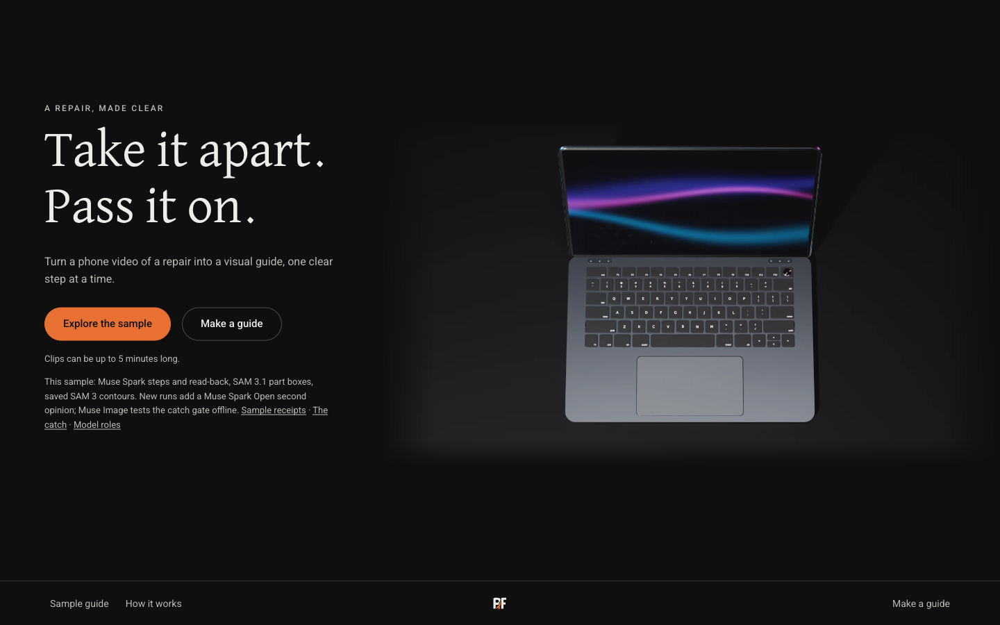

# PartFidelity

Turn a repair video you filmed into an illustrated, step-by-step guide that a
beginner can follow, with the parts that matter outlined and a hard stop
wherever the job turns dangerous (batteries, glued screens).

**Live:** https://was7mahmed--partfidelity-web.us-east.modal.run
· **Sample guide:** https://was7mahmed--partfidelity-web.us-east.modal.run/guide/sample
· **How it was built:** `/built` on the live site



*Screenshot of the live home page, taken 2 November 2026 at 1440 px wide. The laptop is a Blender model: the picture holds no repair footage, faces, serial numbers, QR codes or Windows screens. The guide pages show frames from the sample repair video, so none is pictured here (see "What is not in this repository").*

## Judge index

Built Oct 26–Nov 4, 2026; this public repo is a curated publication of that work. It is a set of publication
snapshots, not the full build history, so its commit log does not show how the work progressed day by day.
The event dates are the ones stated on `/built` (`config/built.toml`); the repository link is on that page too.

**Implemented stages** (details in [How it works](#how-it-works) and `docs/FEATURES.md`): upload and your confirmation,
Muse Spark step extraction (three runs), SAM 3.1 boxes for the fan and battery, a Muse Spark label read-back, a
Muse Spark Open (open weights) second check that only flags a label for a person, the guide page with its hard stop,
and a receipt page for every model call.

**Safety invariants:** the hard stop is described under "How it fits together" below and in the `docs/FEATURES.md`
entries [Deterministic repair guardrails](docs/FEATURES.md#deterministic-repair-guardrails) and
[Live reader stop](docs/FEATURES.md#live-reader-stop); the code is [`app/hazards.py`](app/hazards.py) and
[`static/reader_stop.js`](static/reader_stop.js), with tests in [`tests/test_hazards.py`](tests/test_hazards.py) and
[`tests/test_hard_stop.py`](tests/test_hard_stop.py).

**Proof pages on the live site** (`/built` itself links only the recorded probe and simulated replay, `/disagreement-replay`):
[the sample guide's hard stop](https://was7mahmed--partfidelity-web.us-east.modal.run/guide/sample#step-5),
[the sample's call receipts](https://was7mahmed--partfidelity-web.us-east.modal.run/calls/b3f79c933e2043afc3906a159f473a2b),
[receipts of a newer, separate job that ran the second check](https://was7mahmed--partfidelity-web.us-east.modal.run/calls/6c1f4106e797d0dcf779425a66d48872),
[the recorded probe and simulated replay](https://was7mahmed--partfidelity-web.us-east.modal.run/disagreement-replay),
and [the catch page](https://was7mahmed--partfidelity-web.us-east.modal.run/catch), a controlled demonstration on a small frozen set.

**Reading the evidence:** the sample's own receipts show four failed second-check rows followed by four successful ones;
the saved rows do not say why the first four failed, so none is guessed here. The newer job's four rows all succeeded.
A second-check disagreement asks a person to look; it is not a finding that a label is wrong. The Glimmer offline
probe was run once on a Linux VM (a declared, not independently reproduced row) and never on a Mac, so nothing here shows it running on a laptop.

## Who it is for

Repair-shop technicians and makers who already film their teardowns, and the
beginners who read the guides afterwards. You upload a clip you own (up to 5
minutes, 100 MB); you get a guide with step cards, approximate times, a tools
list and safety warnings. The sample guide was made by one real run of the
site on a 214-second ThinkPad repair video; the fan and battery are the parts it locates.

## How it works

| Stage | What does it | Notes |
| --- | --- | --- |
| Step extraction | Meta Muse Spark | Reads the video, returns a strict step list; three runs are compared and a disagreement fails closed. |
| Part localization | Meta SAM 3.1 (hosted) | Returns a scored box for the fan and battery in selected frames. The live app only gets boxes. The sample guide's outlines are different: open-weight SAM 3 traced each saved box into a pixel mask offline, and those saved sample contours ship with the sample. A new guide draws its outline from the box, which is not pixel-accurate segmentation. |
| Label second opinion | Meta Muse Spark Open (open weights) | Runs in the background, never changes a label; a disagreement flags it for a person. Agreements are shown on the call receipts. No accuracy is claimed. |
| Service | FastAPI, SQLite, Modal | One restartable service; every model call leaves a receipt on its `/calls/<job>` page. |

Model names and page content live in `config/*.toml`; upload limits are set in
`app/settings.py`.

### How it fits together

```
upload                    app/uploads.py, app/admission.py   preview, your confirmation, then job admission
  -> step extraction      app/pipeline.py, app/providers/meta_spark.py   Muse Spark reads the video, three runs
  -> part outlines        app/sam.py, app/providers/meta_sam.py          SAM 3.1 boxes for the fan and battery, drawn as outlines
  -> label checks         app/readback.py, app/providers/open_readback.py
                          Muse Spark read-back, then the Muse Spark Open (open weights) second check in the background
  -> guide and receipts   app/guides.py, app/hazards.py, app/routes/guides.py   the guide page and its hard stop
                          app/evidence.py, app/routes/calls.py                  one receipt per model call, at /calls/<job>
```

- **Spend is reserved before any model call.** `app/ledger.py` holds a job's worst-case cost first and settles the real cost after; a call that cannot be reserved is not sent.
- **The hard stop is enforced in the page.** `app/hazards.py` picks the stop from fixed safety text (models propose tags, never wording); `static/reader_stop.js` and the stop CSS fold the later steps to their warnings until the person acknowledges. The offline export uses a checkbox for the same fold.
- **Muse Image is not in this path.** It only made the frozen edit-check test set, run offline by `tools/catch_table.py`; its recorded results are on `/catch`.

## Honest limits

- Only the fan and battery are located. Other parts are named in the steps but not outlined.
- Step times are approximate, and a step the footage never shows (here, the battery disconnect) is flagged as a gap, not invented.
- The sample comes from a single repair. It shows a working pipeline, not measured accuracy or adoption.
- The edit check on `/catch` is a controlled demonstration on a small frozen set, not an accuracy figure.

## What is not in this repository, and why

Footage and everything cut from it stay out of git because repair video is
personal and can show identifiers. The sample guide and its clip are served by
the live demo; the footage and the stills cut from it are not in this repository.
The source clip was filmed by a friend of the author who gave written
permission; no name or permission record is published. A test that needs
footage skips when it is absent, so nothing below needs it.

## Run the code and the tests

```sh
uv venv --python 3.12 .venv
uv pip install --python .venv/bin/python -e '.[test]'
.venv/bin/python -m pytest -q tests/test_built.py tests/test_catch_navigation.py tests/test_outline.py
make verify-public                       # the whole tests/ tree (long)
```

The demo video tooling (`demo/`, `config/demo_*.toml`) is render-time only; the footage it renders is not shipped. Its caption word filter and
cut validator are advisory lint, not guarantees; what the video says is pinned by the exact `[captions] approved` list in each
config (`tests/test_demo_captions.py`). Machine paths come from `PF_FFMPEG`, `PF_PLAYWRIGHT_FROM` and `PF_FOOTAGE_ZIP`.

To serve locally without the sample media: `.venv/bin/partfidelity` (uvicorn, 127.0.0.1:8000).
Without the sample media, the sample route serves an illustrated
fallback (`app/routes/site.py`), not the filmed guide. Production mode needs
`PARTFIDELITY_PRODUCTION=1`, `PARTFIDELITY_DATA_ROOT` and `META_API_KEY` in the
process environment and refuses to start without them; the key is never logged,
never read from a file and never baked into an image.

## Deploy

The live site is the Modal app in `deploy/modal_app.py`, configured by
`deploy/modal_deploy.toml` (its secret holds the Meta and Baseten keys; none is
in this repository). For a plain VM, `Dockerfile`, `deploy/partfidelity.service`
(systemd) and `deploy/Caddyfile` (automatic HTTPS) are the equivalent files.

## Licence

MIT, see `LICENSE`.

## Where things are

- `docs/FEATURES.md`: every feature and why it exists.
- `app/contracts.py`: the frozen shapes shared between stages.
- `tools/catch_table.py`: the offline edit-check evaluation (`calibrate` then `evaluate`, on a folder of labelled candidates).
- `assets/3d/`: the Blender scenes for the home film; every model and texture is made in code, with sources in `assets/3d/teardown/SOURCES.md`.
